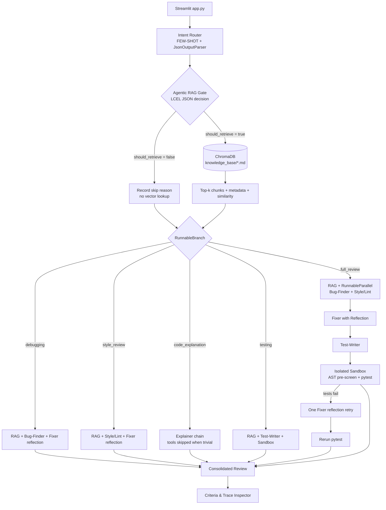

# Code Review & Debug Squad

**Assignment 2 — a multi-agent code review assistant built with Python, Streamlit, LangChain LCEL, ChromaDB, and an isolated test sandbox.**

Submit a Python snippet and a natural-language request. The app detects intent, decides *autonomously* whether to retrieve coding guidelines, routes the work through specialised LCEL agents, applies static analysis, and executes generated pytest tests inside a disposable sandbox. Every decision, prompt, tool call, and output is inspectable in the **Criteria & Trace Inspector** tab.


---

## 1. Quick start

### Windows 11 (PowerShell)

```powershell
cd C:\path\to\Assignment
python -m venv .venv
.\.venv\Scripts\Activate.ps1
python -m pip install --upgrade pip
pip install -r requirements.txt
Copy-Item .env.example .env
streamlit run app.py
```

### macOS / Linux

```bash
python3 -m venv .venv
source .venv/bin/activate
pip install -r requirements.txt
cp .env.example .env
streamlit run app.py
```

The app opens at `http://localhost:8501`.

**No credentials are required for the first run.** `LLM_PROVIDER=demo` is the default and uses a deterministic local `BaseChatModel` so the entire GUI, routing, RAG, prompts, reflection, and sandbox workflow can be evaluated offline.

### First startup

1. `sentence-transformers/all-MiniLM-L6-v2` is loaded locally (downloaded once, then cached). If the model cannot be loaded, a deterministic local hashing embedder is used automatically so the app still works offline.
2. The four Markdown files in `knowledge_base/` are split by section, chunked, embedded, and persisted to `./chroma_db` **only if the collection is empty**.
3. ChromaDB status, chunk count, embedding backend, and source files appear in the sidebar.

### Use a real hosted LLM

Edit `.env`:

```env
LLM_PROVIDER=google
LLM_MODEL=gemini-2.0-flash
GOOGLE_API_KEY=your_key_here
```

or use any OpenAI-compatible endpoint:

```env
LLM_PROVIDER=openai
LLM_MODEL=gpt-4o-mini
OPENAI_API_KEY=your_key_here
OPENAI_BASE_URL=https://api.openai.com/v1
```

You can also paste the key and choose the model/provider in the sidebar. Use **Test LLM connection** to make a real probe call and see latency.

### Use local Ollama

```powershell
ollama serve
ollama pull qwen2.5-coder:7b
```

```env
LLM_PROVIDER=ollama
LLM_MODEL=qwen2.5-coder:7b
OLLAMA_BASE_URL=http://localhost:11434
```

The sidebar has an Ollama URL field and a connection probe that checks `/api/tags` and whether the selected model is installed.

---

## 2. Architecture



### Route contracts

| Intent | Route |
| --- | --- |
| `debugging` | Agentic RAG → Bug-Finder → Fixer with Reflection |
| `style_review` | Agentic RAG → Style/Lint (few-shot) → Fixer with Reflection |
| `code_explanation` | Explainer chain; AST/lint/sandbox and RAG skipped for trivial snippets |
| `testing` | Agentic RAG → Test-Writer → Isolated sandbox |
| `full_review` | Agentic RAG → `RunnableParallel(Bug-Finder, Style/Lint)` → Fixer Reflection → Test-Writer → Sandbox → one retry on failure |

---

## 3. The four required agents

| Agent | Implementation | Grounding / technique |
| --- | --- | --- |
| **Bug-Finder** | `agents.BugFinderAgent` | AST/lint tool report, retrieved bug patterns, **Chain of Thought** trace before `### BUG-n` findings |
| **Style/Lint** | `agents.StyleAgent` | Ruff subprocess + AST readability metrics, **Few-Shot** PEP 8 examples, retrieved style guide |
| **Fixer** | `agents.FixerAgent` | Consumes both reports, emits complete file, then a **mandatory Reflection** call critiques the patch against findings and optionally sandbox failures |
| **Test-Writer** | `agents.TestWriterAgent` | Structured JSON pytest plan, normal + edge cases, executed by `sandbox.py`; full-review route permits **one reflection retry** on failure |

There is also an **Explainer** chain for the `code_explanation` route.

### Prompt engineering

All prompt text lives in `prompts.py` and uses explicit `System` and `User` messages:

- **Few-Shot Prompting** — Intent Router (five labelled examples) and Style/Lint Agent (calibrated review examples).
- **Chain of Thought** — Bug-Finder must write a numbered parse → control-flow → data-flow → edge-case → tool-grounding trace before findings.
- **Reflection** — Fixer's second LCEL chain performs a `REFLECTION PASS`; the full-review route can feed exact pytest stdout/stderr back for one self-correction.
- **Structured outputs** — `JsonOutputParser(pydantic_object=...)` for intent, RAG decision, and test plan.

The exact rendered System/User prompts, including few-shot exemplars and injected RAG context, are displayed in the trace inspector.

---

## 4. Mandatory acceptance criteria — where to verify each one

| # | Criterion | Implementation | Live verification in the GUI |
| --- | --- | --- | --- |
| **1** | **LLM integration** | `config.build_llm()` supports Google Gemini, OpenAI-compatible APIs, and local Ollama via LangChain chat models. `.env.example` documents every setting. Secrets are never written to the trace. | Sidebar **01/02** selects provider/model and key/URL. **Test LLM connection** performs a real probe and shows latency/status. In demo mode the same status panel is intentionally labelled *Offline Demo*. |
| **2** | **Interactive GUI** | `app.py` with sidebar presets/provider controls/re-index plus a light/dark workspace toggle; main code editor, request box, five quick intents; four output tabs. | All controls are visible on one screen. Quick buttons set the request *and* run immediately. The sidebar **Dark mode** switch re-themes the full workspace. |
| **3** | **Prompt engineering** | Explicit System/User `ChatPromptTemplate`s in `prompts.py`; Few-Shot, CoT, Reflection are labelled in `PROMPT_CATALOG`. | **Criteria & Trace Inspector → 3 · Prompts used** shows technique pills and exact rendered messages for every agent. |
| **4** | **LangChain LCEL** | Every agent is `prompt \| llm \| StrOutputParser` or `... \| JsonOutputParser`. Routing uses `RunnableBranch`; full review uses `RunnableParallel`; post-processing uses `RunnableLambda`. No `LLMChain`. | **Criteria & Trace Inspector → 1 · Intent & route** shows `RunnableBranch → full_review`; architecture panel shows the chain composition. Prompt records show every LCEL invocation. |
| **5** | **Agentic RAG gate** | `rag_gate.py` runs a JSON decision chain first, then queries ChromaDB **only** when `should_retrieve=true`; injects top-k chunks, source filenames, and scores. | **2 · Agentic RAG decision** shows boolean, generated query, reason, retrieval-executed state, table of hits with source/section/similarity/distance, and exact chunk text. Run **Explain Code** on the trivial preset to see an autonomous `false` decision with zero hits. |
| **6** | **Intent detection & routing** | `router.py` structured router plus `build_intent_branch()` over five routes. Fallback keyword router if the LLM response cannot be parsed. | **1 · Intent & route** shows detected intent, confidence, decision source, route description, and the exact `RunnableBranch` path. Five quick buttons exercise all five routes. |
| **7** | **ChromaDB knowledge base** | `vector_store.py` uses `langchain-chroma`, persistent `./chroma_db`, section-aware markdown chunking, local HuggingFace embeddings with deterministic offline fallback, and first-start auto-ingest. | Sidebar shows collection, chunk count, backend, sources, and **Re-index knowledge base**. Trace criterion 7 shows persisted chunk metadata; hit chunks show source filenames. |

### Five-minute evaluation script

1. Keep **Offline Demo** selected; wait for the ChromaDB status card.
2. Load **Off-by-one & zero-division** preset → click **Full Squad Review**.
3. **Consolidated Review**: bug report, style report, reflection, and test status.
4. **Fixed Code & Diff**: unified diff and downloadable `fixed_solution.py`.
5. **Test Results (Sandbox)**: exact command, exit code, stdout/stderr, generated pytest file.
6. **Criteria & Trace Inspector**: seven-criterion evidence, RAG hits, exact prompts with Few-Shot/CoT/Reflection tags, AST/Ruff output, sandbox command, raw trace JSON.
7. Load **Trivial function (RAG-skip demo)** → click **Explain Code**. Confirm `should_retrieve=false`, zero Chroma hits, no AST/lint tool calls, and no sandbox.
8. Switch provider to Gemini/OpenAI/Ollama if configured → **Test LLM connection** to exercise the live transport, then run a review.

---

## 5. Project structure

```text
Assignment/
├── app.py                       # Streamlit GUI + all four tabs
├── config.py                    # env loading, config, LLM factory, provider status
├── demo_llm.py                  # deterministic offline BaseChatModel (demo transport)
├── prompts.py                   # all System/User prompts; Few-Shot, CoT, Reflection
├── vector_store.py              # ChromaDB persistence, chunking, ingestion, search
├── rag_gate.py                  # two-step Agentic RAG decision + conditional retrieval
├── router.py                    # intent detection + RunnableBranch assembly
├── agents.py                    # 4 agents + Explainer + LCEL orchestrator
├── tools.py                     # AST analysis + Ruff/Flake8 subprocess + built-in checks
├── sandbox.py                   # temp-dir pytest runner with AST safety screen
├── knowledge_base/
│   ├── pep8_style_guide.md
│   ├── python_bug_patterns.md
│   ├── pytest_testing_guide.md
│   └── debugging_examples.md
├── tests/
│   ├── test_sandbox.py
│   ├── test_router.py
│   ├── test_vector_store.py
│   ├── test_prompts.py
│   └── test_squad_integration.py
├── .streamlit/config.toml
├── requirements.txt
├── .env.example
└── README.md
```

---

## 6. Isolated sandbox

`sandbox.py` runs generated tests in `tempfile.TemporaryDirectory()` with **no Docker**:

- Fresh temporary CWD and only `solution.py` + `test_solution.py` are written.
- `subprocess.run(..., timeout=5, shell=False)` enforces a hard limit.
- Environment allow-list excludes API keys, Ollama URLs, and host `PYTHONPATH`; `PYTHONPATH` is set to the temp directory.
- AST pre-screen blocks `os`, `sys`, `subprocess`, `socket`, `shutil`, network modules, `eval`/`exec`/`open`, dangerous attributes such as `rmtree`/`system`/`popen`, and absolute database paths.
- `pytest` is the default runner; an explicit `unittest` fallback is supported.
- All command text, exit code, timeout, blocked reasons, stdout, and stderr are surfaced in the GUI.

The safety screen is designed for generated tests and accidental damage, **not** as a hostile-code OS sandbox. Do not treat it as a substitute for a container or VM when executing untrusted third-party code.

---

## 7. Tests

```powershell
.\.venv\Scripts\python.exe -m pytest -q
```

The suite covers:

- Safe/failing/timeout sandbox runs, dangerous imports/calls/paths, unittest fallback.
- All five intent classifications, `RunnableBranch` selection, fallback routing.
- RAG gate skip and retrieve paths, metadata/scores/context.
- First-start auto-ingest, similarity search, persistence, re-index.
- Prompt technique requirements.
- End-to-end offline runs of **all five routes**, including:
  - full review with `RunnableParallel`, static analysis, reflection, tests, trace evidence, and the one-retry sandbox-feedback path;
  - trivial explanation with autonomous RAG skip and no tools;
  - debugging, style, and testing routes.

Expected result: `36 passed`.

---

## 8. Configuration reference

| Variable | Default | Meaning |
| --- | --- | --- |
| `LLM_PROVIDER` | `demo` | `google`, `openai`, `ollama`, or `demo` |
| `LLM_MODEL` | provider default | Model ID |
| `LLM_TEMPERATURE` | `0.1` | Sampling temperature |
| `GOOGLE_API_KEY` / `GEMINI_API_KEY` | — | Gemini credential |
| `OPENAI_API_KEY` | — | OpenAI-compatible credential |
| `OPENAI_BASE_URL` | `https://api.openai.com/v1` | Custom compatible endpoint |
| `OLLAMA_BASE_URL` | `http://localhost:11434` | Local Ollama server |
| `CHROMA_DB_DIR` | `./chroma_db` | Persistent Chroma directory |
| `CHROMA_COLLECTION` | `coding_guidelines` | Collection name |
| `KNOWLEDGE_BASE_DIR` | `./knowledge_base` | Curated markdown directory |
| `RAG_TOP_K` | `4` | Retrieved chunk count |
| `EMBEDDING_MODEL` | `sentence-transformers/all-MiniLM-L6-v2` | Local embeddings |
| `SANDBOX_TIMEOUT_SECONDS` | `5` | Hard test timeout |
| `MAX_TEST_RETRIES` | `1` | Fixer reflection retries after failed tests |

---

## 9. Design notes

- **No deprecated `LLMChain`.** Orchestration is entirely LangChain Core runnables and LCEL.
- **RAG is genuinely conditional.** A false gate decision is a first-class, visible path; no Chroma query is executed and the trace says so.
- **Reflection is a separate model call.** The initial fixer patch and the critique/final-code pass are distinct LCEL chains, both visible in the prompt inspector.
- **No silent sandboxing.** Unsafe submissions are reported as blocked before execution; timeouts and exit codes are shown.
- **Offline demo is transparent.** It exists so evaluators can run every screen without credentials. The sidebar and trace always label it, and the hosted/Ollama adapters use the same chain interfaces.
- **Local-first embeddings.** MiniLM runs on CPU; a deterministic hashing fallback prevents the GUI from becoming unusable on a machine that cannot download the model.
